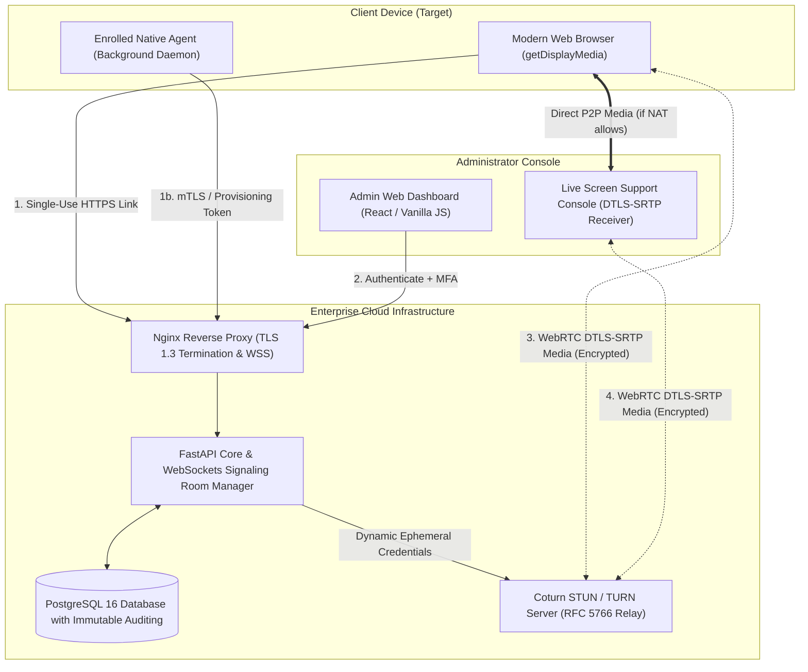
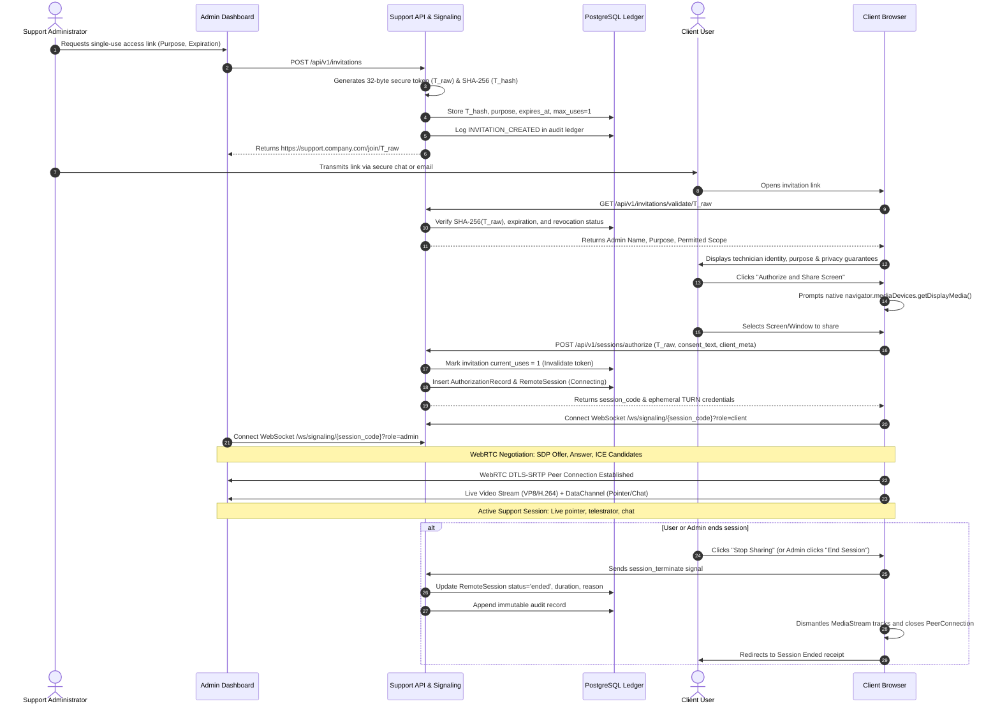
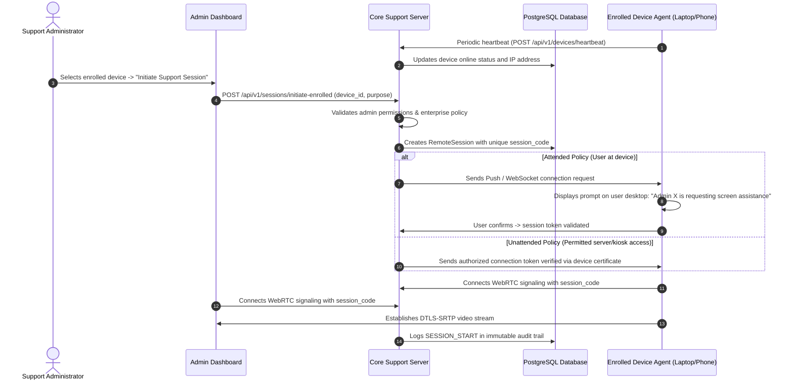

# System Architecture & Technical Specification

## 1. High-Level Architecture Overview

The Secure Remote Device Access Platform connects client devices to an administrator's operations dashboard via authenticated WebRTC peer-to-peer data and media pipelines, coordinated by a hardened backend signaling service.

---

## 2. Secure Access-Link Workflow (Sequence Diagram)

This sequence diagram illustrates the lifecycle of a single-use remote support session, enforcing explicit user consent, cryptographic token hashing, and immediate revocation upon session termination.

---

## 3. Enrolled Device Reconnection Workflow

For enterprise-owned endpoints with the background management agent installed:

---

## 4. Threat Model & Mitigations (STRIDE Framework)

| STRIDE Category | Threat Description | Architectural Mitigation |
| :--- | :--- | :--- |
| **Spoofing** | Adversary attempts to impersonate an administrator or forge an invitation. | Mandatory MFA (TOTP) for admins; Single-use 256-bit entropy tokens; SHA-256 token hashing; TLS 1.3 certificate validation. |
| **Tampering** | Interception or modification of live screen video or chat in transit. | Mandatory WebRTC DTLS-SRTP encryption (AES-128/256-GCM); WebSocket TLS encryption; Strict CSP and HSTS headers. |
| **Repudiation** | An administrator claims they did not initiate a remote session or accessed unauthorized devices. | Append-only immutable `audit_logs` table protected with PostgreSQL database rules preventing UPDATE and DELETE; client IP, user-agent, and consent signatures recorded. |
| **Information Disclosure** | Leakage of access tokens from database dumps or URL referrer headers. | Single-use raw tokens are **never stored** in the database (only salted SHA-256 hashes are persisted); `Referrer-Policy: strict-origin-when-cross-origin`. |
| **Denial of Service** | Flooding login endpoints or TURN relay servers to exhaust bandwidth. | Nginx rate-limiting zones (`limit_req_zone`); RFC 5766 ephemeral HMAC TURN credentials prevent open relay abuse. |
| **Elevation of Privilege** | An attacker using a web link to gain shell execution or root access. | Zero native code execution from the browser sandbox; the link uses browser-native `getDisplayMedia` with no OS-level input injection capability. |

